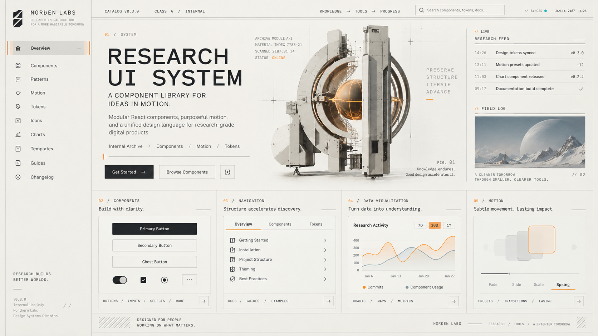

# WzRhineLab UI

面向 React + Motion 的原创科研机构 / 档案终端风格设计系统。

[](https://www.npmjs.com/package/@wzrhine/react)
[](https://www.npmjs.com/package/@wzrhine/agent)
[](./LICENSE)
[](https://baizhi967.github.io/WzRhineLab-UI/)

> 设计灵感来自《明日方舟》莱茵生命的科研机构、档案、航天信息表达，但本项目非官方项目，不使用原作的商标、标识、人物、专有素材或原始 UI 资源。完整声明见[免责声明与商标归属](#免责声明与商标归属)。



**[在线 Showcase](https://baizhi967.github.io/WzRhineLab-UI/)**：组件页、Playground、状态矩阵、动效对照与 Agent 工作台演示，随 main 分支自动部署。

## 特性

- **原创视觉语言**：科研机构 / 档案终端风格；明 / 暗 / system 三主题 × 双密度，全部由 `--rl-*` 语义 token 驱动，不污染 `:root`。
- **可访问性优先**：语义 HTML、完整键盘路径；所有实际使用的前景 / 背景组合在三种主题下由测试验证满足 WCAG 2.2 AA；动效尊重系统减少动态且可中断。
- **两组件体系**：`@wzrhine/react`（83 个组件，交互底座 Base UI）与 `@wzrhine/agent`（87 个 Agent UI 组件：工作台、会话流、composer、工具调用、审批干预、终端、产物预览）。
- **框架无关的 Agent 契约**：`@wzrhine/agent-core` 用 view-model 与纯函数描述会话 / 运行 / 工具 / 审批，不依赖 React，可在任意框架或 Node 中使用；UI 层只做渲染——view-model 进、actions 出。
- **干净的包工程**：入口无 CSS 副作用、样式显式导入；支持 tree-shaking（只引 `Button` 的体积为全量入口的 1.4%）；三浏览器内核 E2E、视觉回归基线、体积预算与 tarball 真实安装验证构成发布门禁。

## 包

| 包 | 定位 | 导出 |
| --- | --- | ---: |
| [`@wzrhine/tokens`](https://www.npmjs.com/package/@wzrhine/tokens) | 设计令牌：`--rl-*` CSS 变量、类型化清单、对比度工具 | 34 |
| [`@wzrhine/react`](https://www.npmjs.com/package/@wzrhine/react) | React 组件库（83 个组件，Base UI 底座） | 294 |
| [`@wzrhine/effects`](https://www.npmjs.com/package/@wzrhine/effects) | 可选展示动效：解密 / 扫描 / 轨道 / 动效播放器 | 24 |
| [`@wzrhine/agent-core`](https://www.npmjs.com/package/@wzrhine/agent-core) | 框架无关 Agent 契约：view-model 与纯函数 | 138 |
| [`@wzrhine/agent`](https://www.npmjs.com/package/@wzrhine/agent) | Agent UI 组件（87 个组件） | 400 |

导出数字来自自动生成的 [API reports](docs/README.md#额外资料与导入)，完整签名以 [docs/api/](docs/api) 为准。

## 快速开始

React 19 · motion 14（peer 依赖）：

```sh
pnpm add @wzrhine/react @wzrhine/tokens react react-dom motion
```

```tsx
import '@wzrhine/tokens/styles.css';
import '@wzrhine/react/styles.css';
import { Button, Field, Input, RhineProvider } from '@wzrhine/react';

export function App() {
  return (
    <RhineProvider theme="light">
      <Field label="记录编号" description="格式 ARC-0000。">
        <Input mono />
      </Field>
      <Button variant="primary">保存记录</Button>
    </RhineProvider>
  );
}
```

- 入口没有 CSS 副作用，样式需像上面一样显式导入（[ADR-0002](docs/development/adr/0002-source-exports-and-style-entry.md)）。
- Dialog、AlertDialog、Drawer、Select、Tooltip、Popover、Menu、Toast 等弹层组件必须放在 `RhineProvider` 内，才能继承主题、locale 与减动设置。

使用 Agent UI 时，在 React 样式之后再导入：

```sh
pnpm add @wzrhine/agent @wzrhine/agent-core
```

```tsx
import '@wzrhine/agent/styles.css';
import { AgentShell } from '@wzrhine/agent';
```

## 文档与展示

- [在线 Showcase](https://baizhi967.github.io/WzRhineLab-UI/)：组件页、Playground、状态矩阵、动效对照、Agent 工作台。
- [docs/README.md](docs/README.md)：文档总入口（规范、组件说明、API 报告、质量门禁）。
- [DESIGN.md](DESIGN.md)：设计定位与原则。
- [概念图册](docs/concepts/README.md)：高保真视觉参考。
- [CHANGELOG](packages/react/CHANGELOG.md) · [UPGRADING](docs/development/UPGRADING.md) · [RELEASING](docs/development/RELEASING.md)
- 集成示例 [examples/](examples/README.md)：独立 SPA、嵌入非 React 旧页面、SSR 水合、App Router。

## 参与开发

需要 Node.js 20.19+ 与 Corepack / pnpm 10：

```sh
pnpm install
pnpm dev            # 本地 Showcase：http://127.0.0.1:5173
pnpm check          # typecheck + 单元测试 + 构建
pnpm test:e2e       # Playwright（Chromium）
pnpm release:check  # 发布门禁（详见 docs/development/QUALITY-GATES.md）
```

开发前请阅读 [AGENTS.md](AGENTS.md) 与 [CONTRIBUTING](docs/development/CONTRIBUTING.md)。当前主线与各里程碑验收状态见 [ROADMAP](docs/ROADMAP.md)。

## 免责声明与商标归属

- 本项目（WzRhineLab-UI 及 `@wzrhine/*` 各包）是维护者个人开发的**非官方、非商业**开源组件库，用于设计研究与工程实践，与鹰角网络（Hypergryph）及《明日方舟》（Arknights）官方**不存在任何关联、合作或背书**。
- 「明日方舟」「Arknights」「莱茵生命（Rhine Lab）」及相关名称、商标与角色形象归**鹰角网络**所有。本项目命名与视觉气质是对原作科研机构 / 档案美学的致敬，不代表任何官方身份。
- 仓库内的代码、组件实现、设计令牌与文档均为原创；概念图为自行生成的研究素材，不包含、不再分发任何原作的界面资源、图片、字体或音频。
- 设计研究引用的公开资料与社区项目见 [REFERENCES](docs/research/REFERENCES.md)，其权利归各自作者所有。

## 许可证

[MIT](./LICENSE) © 2026 WhiteZhi
