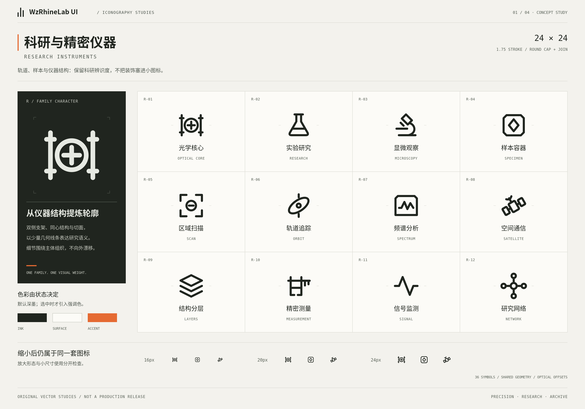
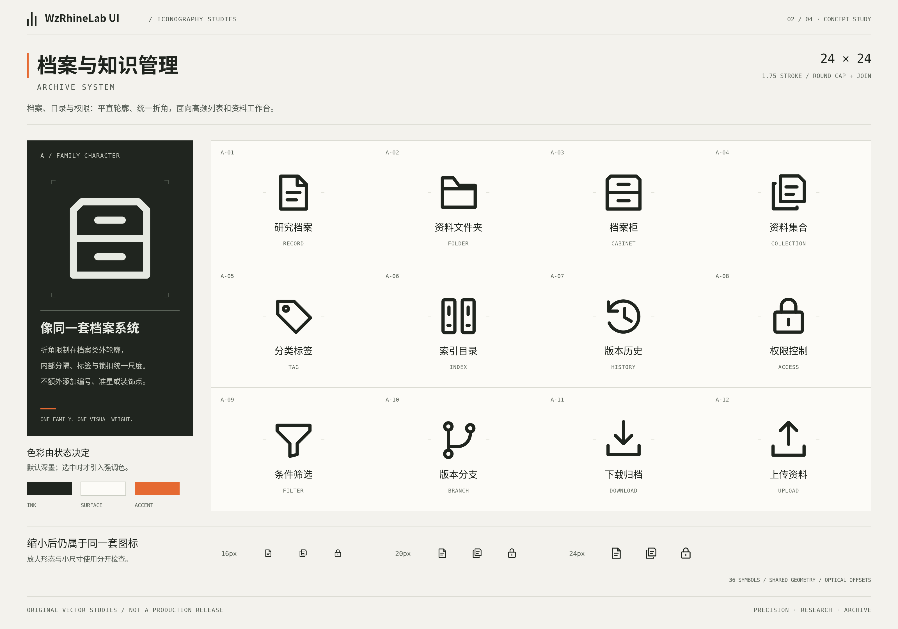
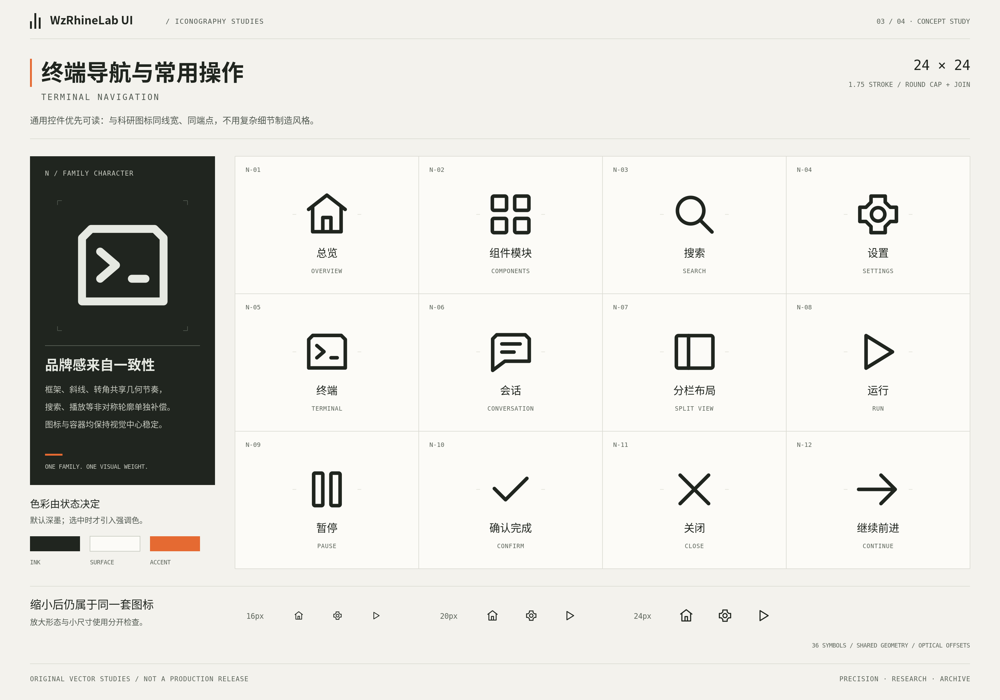
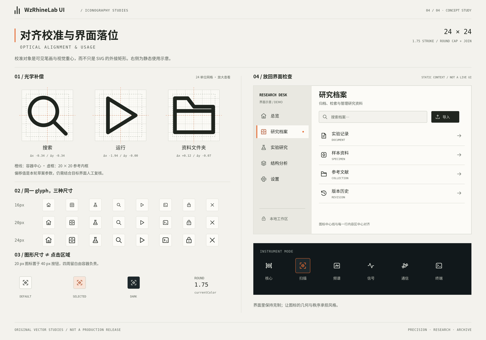

# 参考资产与来源记录

版本：1.0 提案版｜归档日期：2026-10-14

本目录附带上一轮四张参考板的原始PNG，未在本次文档工作中重画或改变颜色。它们用于保持整体方向，不是已经验收的生产图标或浏览器截图。

原始输入：`WzRhineLab_UI_Icon_Reference_Vector_2026-10-14.zip`。  
SHA-256：`e1d9ee5a49740f21254a0c879815f13a53b6eacade83e68e36b56ac49c30f802`。  
包内文件数：94。独立SVG：36；透明PNG草案：36；参考板：4张。

## 四张参考板

### 科研与精密仪器

### 档案与知识管理

### 终端导航与常用操作

### 光学对齐与界面落位

这些图的标题、网格、注释、色块和校准线不是字形的一部分。图中显示的总translation只属于旧稿，不作为正式补偿规则。

## 数据与说明

- [manifest.json](manifest.json)：原始交付标记，production_ready=false。
- [alignment-metrics.json](alignment-metrics.json)：原始bbox／墨量与总平移记录。
- [ORIGINAL-STUDY-README.md](ORIGINAL-STUDY-README.md)：保留原参考包说明，不把其中现状声明更新成新事实。
- [reference-audit.json](reference-audit.json)：本次解析与重新栅格化诊断，含36枚SVG各自的SHA-256与方法限制。

本规范包不重复打包全部SVG草案；需要正式开发时同时使用上一轮原始参考ZIP。不要对本目录PNG自动描摹来替代矢量源。

本包不包含任何字体文件。参考图没有获得本次新的商标、来源或法律审计背书；正式接入仍须记录来源与许可范围。
